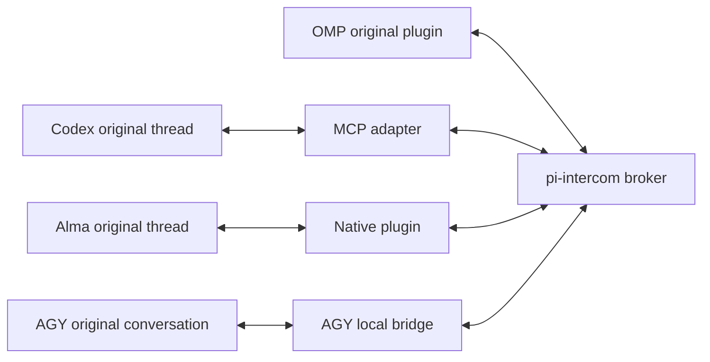

# Agent Intercom

Connect existing OMP, Codex, Alma and Antigravity (`agy`) conversations on the **same machine**, using the original `pi-intercom` broker. Messages stay in the original native threads; the bridge does not spawn a model process or create a replacement conversation for each message.



The OMP plugin and broker protocol are unchanged. Codex identity comes from host-supplied `_meta.threadId`, with delivery through `thread/queue/add`. Alma identity comes from its native host context, with delivery through `steer_generation` using `source: "intercom"`. AGY identity comes from the host-injected `ANTIGRAVITY_CONVERSATION_ID`, `ANTIGRAVITY_SOURCE_METADATA`, `ANTIGRAVITY_LS_ADDRESS`, and `ANTIGRAVITY_CSRF_TOKEN`, verified via `LanguageServerService/GetConversationMetadata` and delivered through `LanguageServerService/SendUserCascadeMessage`.

## Prerequisites and compatibility

- Node.js **22 or newer**, npm, and Git.
- For OMP peers, an existing OMP installation with its original `pi-intercom` plugin enabled. This installer does not install or modify OMP.
- For Codex, a live conversation loaded in the reachable **local shared daemon**. Standalone `codex exec`, `--no-daemon`, remote/desktop threads on another server, and saved transcripts are not supported peers.
- For Alma, the native application and its local service running. Alma is installed as a native plugin, **not** another MCP server entry.
- For AGY (`Antigravity`), a live local CLI or IDE conversation backed by its local Language Server (`ANTIGRAVITY_LS_ADDRESS` and `ANTIGRAVITY_CSRF_TOKEN`). Subagent conversations fail closed.

The existing bridge was exercised on **macOS** with OMP **18.18.8**, Codex CLI **0.167.0** / daemon **0.167.1**, Alma **0.4.567**, and `pi-intercom` **0.18.1**. Linux and Windows are unsupported; other application versions are unverified.

Alma's [official MCP documentation](https://alma.now/docs/features/mcp) documents external tools, not the native hook/WebSocket contract used here. In the tested Alma version, shared MCP connections lack caller-thread identity. The plugin instead captures `tool.willExecute` context in a per-call `WeakMap`; missing context and subagent contexts fail closed. This **undocumented native contract was discovered in the installed application** and can change on upgrade. No Alma application source is shipped.

## Install

```sh
git clone https://github.com/982945902/agent-intercom.git
cd agent-intercom
npm ci --ignore-scripts
node scripts/install.mjs all
```

Select `codex`, `alma`, `agy`, or `all` (the default):

```sh
node scripts/install.mjs codex
node scripts/install.mjs alma
node scripts/install.mjs agy
```

Default locations:

| Item | Location |
| --- | --- |
| Shared runtime | `~/.local/lib/agent-intercom` |
| Codex MCP configuration | `${CODEX_HOME:-$HOME/.codex}/config.toml` |
| Alma native plugin | `${XDG_CONFIG_HOME:-$HOME/.config}/alma/plugins/intercom-bridge` |
| AGY plugin & skill | `${GEMINI_CONFIG_DIR:-$HOME/.gemini/config}/plugins/intercom-bridge` |

For a custom runtime location, pass an absolute path:

```sh
node scripts/install.mjs all --prefix "$HOME/.local/lib/agent-intercom-custom"
```

Keep the installed runtime and Alma plugin in place. The installer generates the plugin's local `bridge-root.json` to point to that runtime; this machine-specific file is not committed. Use the same `--prefix` for later install/uninstall operations.

Existing conflicting installations are not silently overwritten. For an intentional migration, use `--replace-existing` to back up and replace the conflicting installation/configuration:

```sh
node scripts/install.mjs all --replace-existing
```

Keep the backups reported by the installer until you are satisfied with the migration. Conflicting runtime/plugin directories are renamed to adjacent `.<basename>.agent-intercom-backup-<UUID>` directories. The runtime's mode-0600 `.agent-intercom-install.json` records ownership, fingerprints, and any original Intercom configuration section (not the whole Codex config). Keep this local state file; it is not repository content. Do not delete an older runtime while another configured application still uses it. Installation does not restart applications, reload plugins, change approval policy, or grant blanket tool permissions.

For manual Codex configuration, use [`config/codex.toml.example`](config/codex.toml.example), replace its paths with absolute paths, and merge only the Intercom entry into your existing configuration. The outer tool timeout should allow the bridge's ask timeout (the example uses 660 seconds). Do not replace your whole configuration or add permissive approval settings.

The installer supports a conventional `[mcp_servers.intercom]` table with contiguous subtables. It refuses multiline/triple-quoted TOML strings, inline or dotted Intercom declarations, target array tables, and interleaved Intercom subtables rather than risking configuration damage; use the manual template for unsupported layouts. `--replace-existing` authorizes migration only: it does not override changes you made to already-managed files.

### Restart and join

1. Finish or pause active work before refreshing an application. Never restart someone else's active daemon.
2. **Codex:** restart your Codex client or reload its MCP connection so it reads the new configuration. Ensure the intended original thread is loaded in its local daemon.
3. **Alma:** reload the native plugin, or restart Alma when safe. Discover the tools with `ToolSearch` (search for `intercom`). Registration alone does not add all tools to the model's active list.
4. **Each Codex/Alma thread:** call `intercom_join` again after a restart or plugin/MCP reload. Joining is opt-in and sets that native conversation's title when a name is supplied.
5. **OMP:** use the existing `/alias omp-a` and original `intercom` tool. Run `intercom_list` in Codex/Alma or `intercom({action:"list"})` in OMP to check the shared roster.

## Join, route and reply

In a Codex conversation, ask the model:

> Call intercom_join with name codex-a, then intercom_list.

In Alma:

> Use ToolSearch to find intercom. Call plugin--intercom-bridge--intercom_join with name alma-a to join this conversation.

In AGY (`Antigravity`):

> Join Intercom as agy-a and list peers. (Or run `node ~/.local/lib/agent-intercom/agy.mjs intercom_join '{"name":"agy-a"}'`)

Alma prefixes all seven tool names with `plugin--intercom-bridge--`. OMP alone retains `/alias <name>`; Codex and Alma use `intercom_join({name:"..."})`. There is no shell alias or second alias registry. Names are convenient labels; native thread IDs remain stable routing identities.

| Codex/shared tool | Purpose / arguments |
| --- | --- |
| `intercom_join` | Join the current host thread; optional `name`. |
| `intercom_list` | List live peers. |
| `intercom_status` | Show this thread's identity and connection state. |
| `intercom_send` | Deliver `to`, `message` without waiting for a reply. |
| `intercom_ask` | Send `to`, `message` and wait; optional `timeout_ms` (1–600000). |
| `intercom_reply` | Reply with `message` and the incoming message's exact `reply_to`. |
| `intercom_pending` | List unanswered inbound messages and their reply IDs. |

Examples of tool arguments (ask the model to call the named tool):

```text
OMP → Codex: intercom({action:"ask", to:"codex-a", message:"Please review this approach."})
OMP → Alma:  intercom({action:"ask", to:"alma-a", message:"Please review this approach."})
Codex → OMP: intercom_ask({to:"omp-a", message:"What constraints should I consider?"})
Alma → Codex: plugin--intercom-bridge--intercom_ask({to:"codex-a", message:"Please check my conclusion."})
Reply: intercom_reply({reply_to:"<exact incoming message ID>", message:"Here is my conclusion."})
```

Use the qualified reply tool in Alma. The same routing works between two Codex threads or two Alma threads. Prefer `send` unless you need to wait. Only one `ask` may be outstanding per sender. Use `pending` rather than guessing which message needs a reply.

Targets resolve by exact ID, then case-insensitive exact name, then unambiguous ID prefix. Duplicate names can exist in the roster, but ambiguous name routing is rejected: use the **full session ID** from `list`. Self-targeting is rejected.

## Delivery, trust and limitations

- Host identity is not a model-supplied argument. Codex join checks that the exact thread is loaded in the connected daemon; it never resumes a different thread or falls back to `codex exec`. Alma checks that its native thread exists.
- Codex delivery wakes an idle thread or queues behind a busy turn. Interrupted threads may need a human to continue them. Alma starts an idle turn or steers a busy turn without replacing the thread or aborting its current turn.
- A delivery receipt is **not a completed answer**. Alma admission requires a matching persisted user message, not merely a socket write. Use an explicit correlated reply to establish completion; replies match both sender and message ID.
- An ask timeout stops waiting, not work already delivered. Codex MCP cancellation releases the wait; Alma's current plugin API has no abort signal, so asks rely on their timeout. There is no automatic resend, replay, or silent reconnection after transport failure.
- Existing sandbox and approval policies stay in effect. A peer may need human approval before replying. The bridge never answers app-server approval requests on behalf of the owning UI.
- Peer text is labelled as peer content, not a system instruction. Sending can start work under the recipient's existing permissions: use only with trusted local peers. This is a **same-local-user trust model**, not isolation from malicious processes under that account. No remote transport is added.
- Alma wake-up turns activate Intercom tools alongside native base tools and previously discovered tools; global permissions and selections remain unchanged. Busy turns retain their existing tool context and can use `ToolSearch`.
- OMP's existing busy non-UI-session policy may refuse an ask; the bridge does not override it.
- Closing a client or losing its transport takes endpoints offline. Reload the affected MCP connection/plugin and rejoin after failures. Deleting an Alma thread unregisters its endpoint.

### Local configuration

All peers must use the same `PI_INTERCOM_SCOPE_ID` and broker runtime. `PI_CODING_AGENT_DIR` selects the broker runtime; keep it consistent with OMP. `INTERCOM_PACKAGE` can select an installed compatible `pi-intercom` package directory. This package pins `pi-intercom` 0.18.1 rather than copying third-party source.

By default the adapters import their own packaged `pi-intercom` dependency, not a package from the user's OMP plugin directory. They still connect to the same standard broker runtime as OMP.

`CODEX_INTERCOM_SOCKET` can select another reachable local daemon's Unix socket; thread ownership is still checked. By default Codex uses its local control socket under `CODEX_HOME` (or `~/.codex`). Alma uses `http://127.0.0.1:23001`; `ALMA_API_URL` may select another local HTTP endpoint, but remote URLs are rejected. These are runtime environment variables: the application/plugin host must receive them, not just the installer shell.

## Uninstall

From the checkout, select the integration to remove:

```sh
node scripts/uninstall.mjs codex
node scripts/uninstall.mjs alma
node scripts/uninstall.mjs all
# For a custom installation:
node scripts/uninstall.mjs all --prefix "$HOME/.local/lib/agent-intercom-custom"
```

Uninstall restores backed-up originals only when the managed content and backups remain unchanged. Unrelated Codex configuration edits survive; changes to managed configuration, plugin, or runtime cause a safe refusal instead of destructive removal. Read any reported conflicts and review retained files manually. Removing only one integration retains the shared runtime; removing the last managed integration removes the unchanged owned runtime and restores its prior backup, if any. Keep `.agent-intercom-install.json` until removal is complete.

Uninstall does not remove OMP or its original plugin. Restart/reload affected clients yourself when safe; uninstall does not disconnect live users automatically.

## Verification scope

Before packaging, live model ask/reply checks passed for OMP→OMP, OMP→Codex, Codex→OMP, Codex→Codex, OMP→Alma, Alma→OMP, Codex→Alma, Alma→Codex, and Alma→Alma. Successive exchanges reused original native thread identities. These were native tool calls, not simulated model output; no keyboard-driven TUI or Alma GUI-rendering test was performed.

Verification of this packaged version:

- `bridge.test.mjs`: six passing Node test results covering isolated broker behavior and exact Alma admission.
- `scripts/lifecycle.test.mjs`: eleven passing tests covering configuration preservation, migration, partial/final removal, ownership conflicts, symlinks, and disabled dependency install hooks.
- An isolated-home CLI smoke installed all clients with the real locked dependencies from npm's cache, repeated the installation, then uninstalled and restored the original runtime/plugin/configuration while retaining later unrelated settings edits.
- The installed MCP completed an SDK handshake, exposed all seven tools, and rejected missing host identity. The installed Alma entry loaded its configured runtime and rejected calls without the native host hook. This loader check is separate from the earlier real Alma model exchanges.

Run `npm test` for the regression suite. Installation requires npm registry access or an already populated npm cache. CI is configured for Node 22/24 on macOS and Linux; these tests do not establish full application compatibility on other platforms.

## Public repository, licensing

This repository is public by its owner's choice, but **no open-source license has been selected for the project's own code**. Public visibility is not a general permission to reuse or redistribute it. The package is marked `UNLICENSED` and `private: true`; it is not published to npm.

Third-party dependencies retain their own licenses. See [THIRD_PARTY_NOTICES.md](THIRD_PARTY_NOTICES.md). No OMP, Codex, or Alma application source is included.
