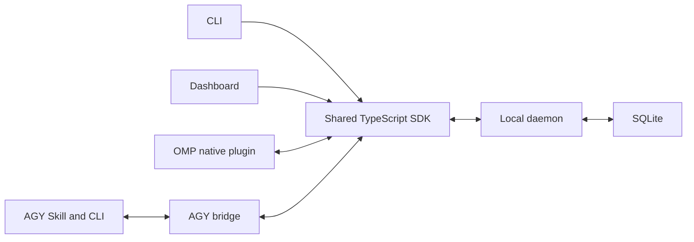

# Agent Intercom

Agent Intercom connects local OMP and Antigravity (AGY) sessions. Pick already-running sessions in the Dashboard or CLI, assign them to a group, and send direct messages, broadcasts, or requests for a correlated reply within that group.



## Start the daemon

Use Node.js 24 and npm from this checkout.

```sh
npm ci
npm run build
node dist/apps/cli/index.js daemon start
node dist/apps/cli/index.js daemon status --json
```

Open the loopback URL printed by `daemon start` to use the Dashboard. Run `npm start` to run the daemon in the foreground. `INTERCOM_RUNTIME_DIR` selects the socket and database directory and defaults to `~/.agent-intercom/v2`. Use the same directory for the daemon, CLI and host integrations. `INTERCOM_HTTP_PORT` selects the Dashboard port and defaults to an available port.

The examples use `node dist/apps/cli/index.js` from this checkout. Use `npm link` after building if you want the `intercom` command on `PATH`.

## Join from OMP and AGY

**OMP.** Start OMP with the built extension. The top-level session joins on startup and keeps its Intercom ID when resumed. Subagents stay outside the roster. Choose `/intercom-id` to enter a new alias in a dialog, or run `/intercom-id omp-a` to set it directly. `/intercom-alias` opens the same dialog.

```sh
omp -e "$PWD/dist/packages/adapters/omp/index.js"
```

Use `intercom_groups` to list your groups and `intercom_peers` to list visible peers with their shared groups. The extension also exposes `intercom_status`, `intercom_send`, `intercom_ask`, `intercom_reply`, `intercom_pending`, and `intercom_broadcast`. Use `groupId` to choose a route where needed. `intercom_reply` takes `{replyTo, text}` with the exact incoming message ID.

**AGY.** Add the [bundled Skill](packages/adapters/agy/skills/intercom/SKILL.md) to the active AGY skills directory. From the intended top-level conversation, ask AGY to run the following through `run_command`. Use an absolute path to the CLI if it is outside the current workspace or `intercom` is unavailable on `PATH`.

```sh
intercom agy join agy-a --json
intercom agy list --json
intercom agy groups --json
intercom agy ask omp-a 'Can you review the plan?' --timeout-ms 300000 --json
intercom agy reply INCOMING_MESSAGE_ID 'Here is my reply.' --json
```

The bridge uses the conversation context supplied by `run_command`. It verifies the top-level conversation with the local Language Server and injects inbound messages into that conversation. Use `intercom agy pending` to look up unanswered asks.

## Manage live groups

Select sessions in the Dashboard to create a group or add or remove members. A session can belong to several groups at once. Creating a group and adding members preserve existing memberships. Use `group move` to replace all memberships with one group. The roster and message history update live.

```sh
intercom sessions list --online --json
intercom group create review SESSION_ID_A SESSION_ID_B --json
intercom group list --json
intercom group add GROUP_ID SESSION_ID_A SESSION_ID_B --json
intercom group remove GROUP_ID SESSION_ID_A --json
intercom group move GROUP_ID SESSION_ID_A SESSION_ID_B --json
intercom messages list --group GROUP_ID --json
```

A session first joins `default` and restores all its groups when it reconnects. Removing its last group returns it to `default`. Membership changes apply atomically to the selected sessions without restarting their native conversations. Removing a group used by an active ask is rejected. Queued deliveries in a removed group expire. Messages already admitted by a host can continue running.

The daemon checks every five minutes and on startup for sessions that have been offline for at least 24 hours. It removes them from the roster and topology while retaining their IDs, aliases, groups, and message history. Rejoining restores the session to the roster.

Peer lists include the union of online sessions in your groups. Each peer appears once with only the memberships you share. Direct sends and asks require a shared group, inferred when there is exactly one. Choose `groupId` in OMP or `--group GROUP_ID` in AGY when you share multiple groups. Broadcasts always stay within one business group and need an explicit group when you belong to several. A reply uses the original ask’s group. Existing databases keep session IDs, memberships, aliases and message history during migration.

## System services and JoyME Watch

The read-only System group shows the local roster in Dashboard and management CLI. Authorized system services can discover all online sessions. Ordinary sessions can address a service directly without exposing unrelated business peers to each other. A service can notify a session by its stable ID after that session has contacted the service. These conversations use the System group for history and are independent of business membership changes.

For JoyME Watch, build Intercom, start `intercom daemon start`, then set `channels["joyme-watch"].intercomEndpoint` in agent-autoloop’s `config.json` to the absolute path of `dist/packages/adapters/joyme-watch/endpoint.js`. Restart agent-autoloop with `agent-autoloop service install`. Both processes must use the same Intercom runtime directory. The adapter reads the daemon’s owner-only `service-token` file. Keep its contents out of agent prompts and logs.

In OMP or AGY, send an ask to `joyme-watch` with a watch command such as `watch user ACCOUNT ttl=2h`. The watcher replies to the ask and later sends new-message and expiry notices to the subscribing session. Use a separate `channels["joyme-watch"].storeFile` for v2 if migrating from the older broker, and recreate existing subscriptions from the intended v2 sessions. Their subscriber IDs change between brokers.

Session commands can manage the caller’s own watches. Global watcher maintenance stays outside the session interface.

The management API and local runtime directory share the account’s trust boundary. System service credentials distinguish native service registration from ordinary session registration.

## Delivery and SDK

A successful send returns the persisted message and its delivery records. `adapter_received` records adapter receipt, `host_accepted` records host admission evidence, and `delivery_unknown` records an ambiguous outcome. An ask completes when the target sends a correlated reply. Use `messages get MESSAGE_ID --json` or the Dashboard details to inspect a delivery. A timed-out ask can receive a late reply.

`agent-intercom` exports the shared SDK types and browser HTTP/SSE client. `agent-intercom/node` exports local control and native session clients. The SDK owns capability calls, errors and event types. The daemon owns routing, state transitions and group membership. Native adapters own host identity and delivery into the host conversation.

## Verification and migration

Run `npm test` for the daemon, SDK and CLI integration tests. CI runs with Node.js 24 on macOS and Linux.

The v2 branch uses a separate runtime directory and its own OMP and AGY adapters. For a v2 test, load the v2 OMP extension with the previous Intercom extension disabled for that run. The previous broker and Codex/Alma integrations are available on the v1 line. v2 currently ships OMP and AGY.

The project is marked `UNLICENSED` and `private: true`. Dependencies retain their own licenses. See [third-party notices](THIRD_PARTY_NOTICES.md).

